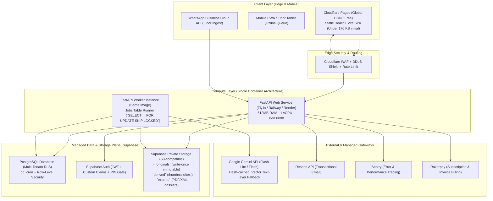

# HeatLedger AI — System Architecture & Cost Guardrails (B1)

> **Specification Reference:** HeatLedger Prompt Pack v2 — Phase 4 (B1 Architecture and Cost Guardrails)  
> **Status:** Draft / Pending Approval  
> **Target Scale:** 1 to 50 Industrial Forging, Casting & Welded Steel Plants  

---

## 1. System Architecture Overview

HeatLedger AI is designed as a **lean, low-overhead, high-security regulatory compliance platform** for Indian steel and engineering exporters facing EU Regulation 2026/1963 and the CBAM Definitive Regime.



---

## 2. Architecture Decisions & Simplicity Rules

1. **Frontend Hosting (Cloudflare Pages):**
   - Unlimited static bandwidth, free commercial tier, instant edge global rollouts.
   - Zero compute bill for marketing pages and static dashboard assets.

2. **Database, Auth & Storage (Supabase):**
   - Free Tier during MVP / local validation; Pro Tier (\$25/mo) once billing live plants.
   - Eliminates dedicated database DevOps, connection pooling via Supavisor, built-in S3-compatible private object storage.

3. **Backend Compute (FastAPI Container):**
   - Packaged in a single Docker image running on Fly.io, Railway, or Render (\$5–\$7/mo).
   - Starts in either `web` mode (`uvicorn main:app`) or `worker` mode (`python -m jobs.worker`).
   - **Zero Redis, Zero Celery, Zero Kubernetes.**

4. **Queue & Background Jobs (`PostgreSQL SKIP LOCKED`):**
   - Queue is implemented with a lightweight `jobs` table using native PostgreSQL:
     ```sql
     SELECT id, payload FROM jobs
     WHERE status = 'queued' AND run_at <= NOW()
     ORDER BY priority ASC, created_at ASC
     FOR UPDATE SKIP LOCKED
     LIMIT 1;
     ```
   - Cron schedules handled by `pg_cron` inside Supabase.

5. **AI Extraction & Cost Optimization:**
   - **Layer 1:** SHA-256 cache check against SQLite / Postgres (cost: **\$0.00**).
   - **Layer 2:** PyMuPDF native vector text-layer parser (cost: **\$0.00**).
   - **Layer 3:** Gemini Flash-Lite for low-confidence or scanned certificates (approx **\$0.0004 / cert**).
   - **Layer 4:** Escalate to Gemini Flash only if confidence drops below 0.70.

---

## 3. Trust Boundaries & Security Enclaves

| Boundary | Inbound Interface | Security Controls Enforced |
| :--- | :--- | :--- |
| **Public Internet $\rightarrow$ Cloudflare Pages** | HTTPS (TLS 1.3) | Strict CSP, HSTS, No-Sniff, X-Frame-Options: DENY |
| **Frontend SPA $\rightarrow$ FastAPI API** | REST (`/api/*`) | JWT Bearer verification, Sliding-Window IP Rate Limiter (10 OCR/min), Honeypot |
| **Floor Staff $\rightarrow$ Signing Gate** | `POST /api/dossier/sign` | Role-based check (`QA_HEAD`), Keyed HMAC-SHA256 signature verification |
| **FastAPI $\rightarrow$ Supabase Postgres** | TLS Connection Pool | Row-Level Security (`organization_id = auth.jwt()->>'org_id'`), Service Role key strictly isolated to internal worker |
| **FastAPI $\rightarrow$ Supabase Storage** | Private S3 API | Pre-signed URLs with short 5-minute expiry, Write-once immutable originals bucket |

---

## 4. Monthly Cost Projections Across 3 Stages

All infrastructure cost assumptions assume low-cost cloud components without unnecessary enterprise markups:

| Infrastructure Component | Stage 1: Building / MVP (1 Plant) | Stage 2: Early Pilots (10 Plants) | Stage 3: Commercial Growth (50 Plants) | Notes & Assumptions |
| :--- | :--- | :--- | :--- | :--- |
| **Cloudflare Pages** | \$0.00 | \$0.00 | \$0.00 | Unlimited bandwidth & requests on free tier |
| **Supabase (Database, Auth, Storage)** | \$0.00 (Free Tier) | \$25.00 (Pro Tier) | \$25.00 + \$10 storage (\$35.00) | 8GB database, 100GB storage included |
| **Compute (FastAPI Web + Worker)** | \$0.00 (Local / Free) | \$14.00 (2 × 512MB Fly.io/Railway) | \$28.00 (4 × 512MB Fly.io/Railway) | Auto-restart, health checked |
| **Gemini AI Extraction** | \$0.50 (Flash-Lite tests) | \$4.00 (~1,000 MTCs @ \$0.004) | \$20.00 (~5,000 MTCs @ \$0.004) | Caching & local PyMuPDF resolves ~70% free |
| **Resend (Transactional Emails)** | \$0.00 (Free Tier: 3,000/mo) | \$0.00 (Free Tier) | \$20.00 (Pro Tier: 50,000/mo) | Shipment release & compliance alerts |
| **Sentry (Error Monitoring)** | \$0.00 (Developer Free) | \$0.00 (Developer Free) | \$26.00 (Team Tier) | 50k errors/mo free tier |
| **WhatsApp Business API** | \$0.00 (Sandbox) | \$10.00 (1,000 conversations) | \$45.00 (4,500 conversations) | Meta utility conversation rate (~₹0.80/conv) |
| **Total Monthly Infrastructure Cost** | **~\$0.50 / month** | **~\$53.00 / month** | **~\$174.00 / month** | **Extremely lean margins** |
| **Monthly Revenue (at ₹9,999/mo)** | ₹0 | ₹99,990 (~**\$1,200/mo**) | ₹499,950 (~**\$6,000/mo**) | **Gross Margin: > 97%** |

---

## 5. Cost Guardrails & Kill Switches

1. **Tenant Spend Limits:**
   - Soft alert at 50% of monthly tier allocation.
   - Warning banner at 80% allocation.
   - **Hard cutoff at 100%:** Fallback to manual entry / local PyMuPDF extraction only; LLM calls paused until plan upgrade or monthly reset.

2. **Global AI Circuit Breaker:**
   - Global ceiling of **\$50.00 / day** on Google Gemini API keys.
   - If exceeded, system immediately fails closed to deterministic regex/vector extraction, logging a critical alert in Sentry.

3. **WhatsApp / SMS Flood Control:**
   - Rate limit: maximum 3 outbound WhatsApp notifications per shipment.
   - Inbound intake limited to 20 documents per hour per phone number.

4. **Emergency Kill Switch:**
   - Environment variable `MAINTENANCE_MODE=true` immediately returns HTTP 503 for non-GET requests while preserving database integrity.
